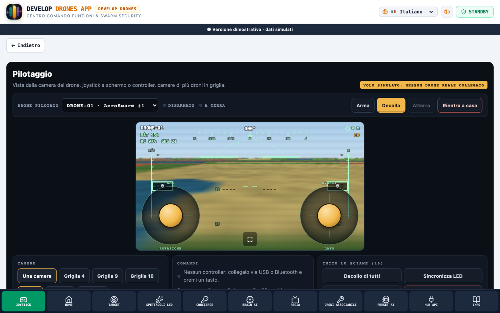
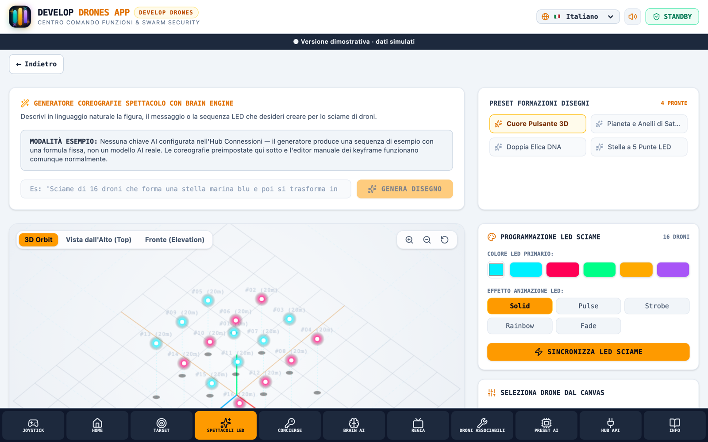
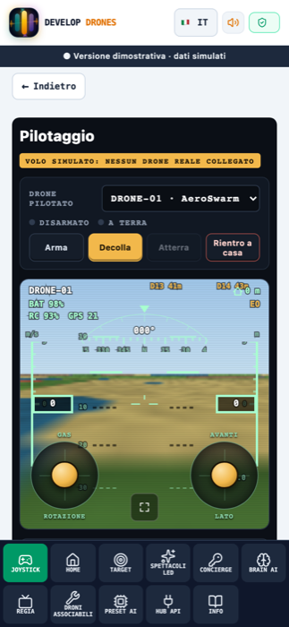

# drone-swarm-ui-prototype

A working prototype of one command panel for a drone swarm: light shows, search missions, manual flight, camera direction and automations.

**Everything on screen is simulated by the interface.** No real drone is connected, no camera feeds are received, and no measurement has been taken on hardware. Settings are not kept: close the app and it starts again from its initial values.

This repository is a showcase (screenshots and description). It does not contain the source code.

## Screenshots

**Piloting panel.** Onboard camera view with on-screen readouts, two on-screen joysticks, one to sixteen camera grid. The banner says it plainly: demo version, simulated data, no real drone connected.

**Light show designer.** A formation editor for aerial shows: ready-made figures, keyframes, LED colour and effect, and a 3D view of the fleet with top and front views.

**On a phone.** The same piloting panel at phone width, with the fixed bar of panels at the bottom.

## What the panels do (on screen)

- Command centre: cards for every module and the state of the swarm.
- Search and rescue: define a target signature, sensor thresholds and a scan pattern, with a sensor view and a detection log.
- Light shows: formation editor, keyframes, LED colour and effects, 3D view of the fleet.
- Piloting: flight view with readouts, on-screen joysticks, game controller or keyboard, one to sixteen cameras.
- Camera direction: one, two, four or nine tiles with optic, thermal, night and 3D views.
- Concierge and automations: simulated relays and watch rules, each one testable with a simulation button.
- Reasoning console: describe a rule in plain words and get a script. In this version the answers are prepared examples.
- Fleet and hardware: the list of associated aircraft and their cards.

## Limits

- It is a prototype, not a finished product.
- Telemetry, camera pictures and detections are generated by the interface.
- The reasoning console answers with prepared examples, not a live decision.
- The interface is Italian. A language selector offers twenty languages, but the translation covers only the top bar, most of the opening screen, the flight panel and the demo banner.
- Windows and Linux desktop packages have not been tested on real machines.

## Try it

Page with the demo and the install options (browser, computer, Android): https://developcontroller.com/drones

## Credits

Written with AI help, reviewed by the author. Capitan AI.
